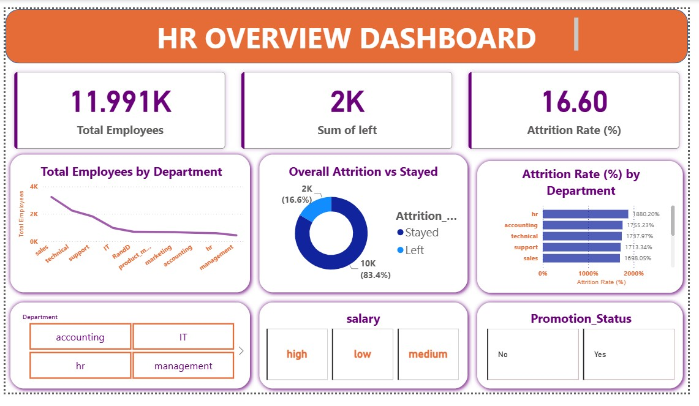
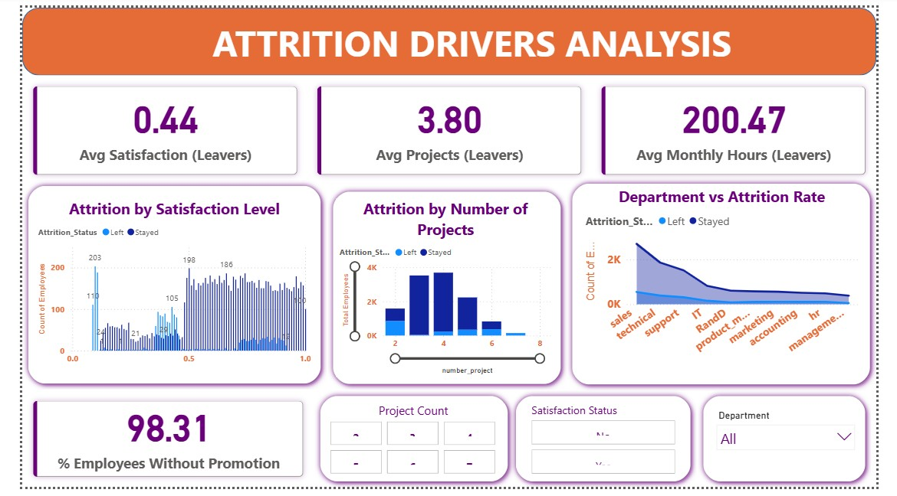
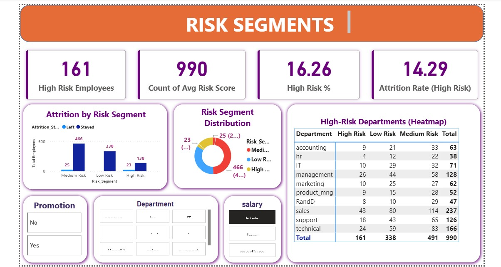

HR Analytics – Employee Attrition & Workforce Analysis

1. Project Overview

This project analyzes employee attrition and workforce trends to understand factors associated with employee turnover and support data-driven HR decisions.

The objective is to explore employee satisfaction, workload, salary, promotion history, department distribution, and attrition risk to identify workforce patterns and potential retention opportunities.

The project uses Excel, SQL, Python, and Power BI as part of an HR analytics workflow.

2. Business Problem Statement

Employee attrition can increase recruitment costs, reduce productivity, and disrupt workforce stability.

The organization wants to understand which employee groups and workplace factors are associated with higher attrition so that HR teams can develop more effective employee engagement and retention strategies.

Main Business Question:

How can HR analytics help identify employee attrition patterns, recognize high-risk employee groups, and support employee retention?

3. Dataset Summary

The project uses an employee HR dataset containing information about:

- Employee satisfaction
- Department
- Salary level
- Average monthly working hours
- Promotion history
- Employee attrition status

These attributes are used to explore workforce trends and employee attrition patterns.

4. Tools and Technologies

Tool| Purpose
Microsoft Excel| Data exploration and analysis
SQL| Data cleaning and business analysis
Python (Pandas, NumPy)| Data preparation and exploratory analysis
Jupyter Notebook| Python development environment
Power BI| Interactive dashboards and visualization

5. Project Workflow

A. Data Exploration and Preparation

The employee dataset was examined to understand its structure and relevant workforce attributes.

Key activities included:

1. Reviewing employee information and dataset structure.
2. Exploring employee satisfaction, salary, workload, and promotion history.
3. Preparing data for further analysis.
4. Identifying workforce characteristics associated with employee attrition.

B. SQL Analysis

SQL was used to explore employee data and investigate workforce patterns.

Key activities included:

- Checking for duplicate records.
- Exploring attrition by department.
- Comparing attrition across salary groups.
- Examining employee satisfaction and workload patterns.

C. Python Analysis

Python libraries, including Pandas and NumPy, were used for data preparation, feature creation, and exploratory data analysis.

The analysis explored employee characteristics and patterns associated with attrition.

D. Power BI Dashboard

An interactive Power BI dashboard was developed to present workforce metrics and employee attrition insights.

The dashboard contains three main sections:

1. HR Overview

2. Attrition Drivers

3. Risk Segments

6. Key Business Insights

The analysis highlighted several patterns:

1. Employees with lower satisfaction levels showed a greater tendency to leave.
2. Employees working more than 200 average monthly hours showed a notable association with attrition.
3. Employees without a promotion in the previous five years showed higher disengagement and exit patterns.
4. Some departments contained a greater concentration of high-risk employees.
5. Employee risk segmentation helped distinguish Low, Medium, and High attrition-risk groups.

These findings represent observed associations in the dataset and do not establish that any single factor directly causes employee attrition.

7. HR Recommendations

Based on the analytical findings, the project proposes the following strategies:

1. Improve Employee Satisfaction: Conduct regular engagement surveys and address employee concerns.
2. Monitor Workload: Identify excessive working hours and introduce workload-management practices.
3. Encourage Career Development: Review promotion opportunities and internal mobility for employees with extended periods without promotion.
4. Focus on High-Risk Departments: Monitor departments with higher concentrations of employees at risk of leaving.
5. Support At-Risk Employees: Encourage proactive engagement with employees identified in the high-risk category.

8. Project Deliverables

The project includes:

1. Employee HR dataset.
2. SQL cleaning and analysis scripts.
3. Python notebook for data preparation and exploratory analysis.
4. Power BI dashboard.
5. Dashboard preview images.
6. Business insights and HR recommendations.

9. Skills Demonstrated

- HR data analytics
- Data exploration and preparation
- SQL querying and analysis
- Python and Pandas
- Exploratory data analysis
- Power BI dashboard development
- Data visualization
- Employee attrition analysis
- Business insights and recommendations

10. Conclusion

This project demonstrates how data analytics can support workforce planning and employee retention.

By exploring employee satisfaction, workload, salary, promotion history, and departmental patterns, the analysis highlights areas HR teams can investigate to better understand attrition and develop informed retention strategies.

11. Acknowledgement

This project was developed with reference to the work of Dhnashri Borse.

Original project: "HR Analytics – Employee Attrition" (https://github.com/dhanashri-analytics26/HR-Analytics-Employee-Attrition)

Credit is given to the original creator for the project reference and source materials.
